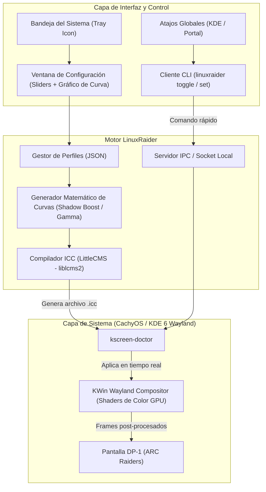
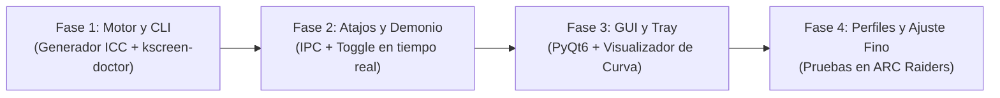

# Plan de Implementación: LinuxRaider

> **Objetivo:** Desarrollar una aplicación nativa para Linux (enfocada en CachyOS con KDE Plasma 6 Wayland) que permita aplicar perfiles de color, curvas de gamma y ecualización de sombras (*Shadow Boost / Black Equalizer*) sobre la imagen procesada por la GPU para mejorar la visibilidad en zonas oscuras en juegos como *ARC Raiders*, con activación instantánea mediante atajos de teclado.

---

## 1. Arquitectura General del Sistema

A diferencia de las soluciones de hardware (que solo aumentan la retroiluminación del monitor), **LinuxRaider** manipula la curva de respuesta tonal digital (**TRC - Tone Reproduction Curve**) a través del pipeline de gestión de color por GPU de KDE Plasma 6 (KWin) utilizando perfiles ICC y `kscreen-doctor`.



---

## 2. Componentes y Módulos

### Módulo 1: Generador de Curvas y Compilador ICC (`engine/icc_builder.py`)
Es el corazón del procesamiento digital de imagen. Construye perfiles ICC v2/v4 estándar sin necesidad de software externo, utilizando la biblioteca `liblcms2` (ya disponible en el sistema).

#### Fórmulas de Transformación Digital:
Para evitar sobreexponer las luces altas (el cielo, disparos, explosiones) mientras se iluminan las sombras profundas (cuevas, interiores de *ARC Raiders*), se utiliza una curva combinada:

1. **Ecualizador de Sombras (*Shadow Lift*):**
   Eleva exponencialmente los tonos en el rango $[0.0, 0.3]$ sin alterar el blanco puro:
   $$y_1 = x + \text{lift} \cdot (1.0 - x)^3$$
2. **Corrección Gamma Dinámica:**
   $$y_2 = x^{\frac{1}{\gamma}}$$
3. **Curva Combinada Mapeada a 256/1024 puntos:**
   Se genera una tabla de consulta (*Lookup Table*) de precisión de 16 bits que se inyecta en los tags `rTRC`, `gTRC` y `bTRC` del perfil ICC.

### Módulo 2: Controlador de Pantalla (`engine/display_controller.py`)
Encargado de comunicarse con KWin de manera atómica:
* **Detección automática:** Consulta `kscreen-doctor -j` para identificar el monitor activo (ej. `DP-1`), su estado de conexión y resolución.
* **Activación instantánea:**
  ```bash
  kscreen-doctor output.DP-1.iccprofile."/home/user/.config/linuxraider/profiles/arc_caves.icc" output.DP-1.colorProfileSource.ICC
  ```
* **Reversión instantánea (Reset):**
  ```bash
  kscreen-doctor output.DP-1.colorProfileSource.sRGB
  ```
* **Latencia:** $\approx 0\text{ ms}$, la GPU actualiza el shader de composición en el siguiente refresco de pantalla.

### Módulo 3: Demonio IPC y Cliente CLI (`cli.py`)
Para que los atajos de teclado respondan en milisegundos mientras juegas sin tener que abrir ventanas:
* Un socket Unix ligero (`/run/user/$UID/linuxraider.sock`).
* Permite comandos instantáneos:
  * `linuxraider toggle`: Alterna entre el perfil de juego y el perfil estándar sRGB.
  * `linuxraider set <perfil>`: Aplica un perfil específico (ej. "cuevas", "noche").
  * `linuxraider reset`: Vuelve a sRGB estándar.

### Módulo 4: Interfaz Gráfica y System Tray (`ui/`)
Diseñada con **PyQt6** para integrarse de forma 100% nativa con el diseño y colores de KDE Plasma 6:
* **Bandeja del sistema:** Permanece oculta mientras juegas, accesible con clic derecho.
* **Deslizadores interactivos:**
  * **Shadow Boost (0 - 100%):** Ilumina zonas oscuras.
  * **Gamma (0.8 - 2.5):** Curva general de exposición.
  * **Contraste digital (0 - 100%):** Ajuste de pendiente de sombras y medios.
* **Gráfico interactivo de la curva:** Muestra visualmente la curva TRC en tiempo real para que el usuario entienda qué rango de sombras está amplificando.
* **Perfiles rápidos:** Crear, guardar y renombrar perfiles por juego o mapa.

---

## 3. Estructura del Código del Proyecto

```text
/home/valentinf/Documents/Projects/LinuxRaider/
├── linuxraider/
│   ├── __init__.py
│   ├── main.py                 # Punto de entrada principal
│   ├── cli.py                  # Interfaz de línea de comandos para atajos
│   ├── engine/
│   │   ├── __init__.py
│   │   ├── icc_builder.py      # Generador LittleCMS de curvas y archivos .icc
│   │   ├── display_manager.py  # Wrapper de kscreen-doctor
│   │   └── curves.py           # Fórmulas matemáticas (Shadow Boost, Gamma, etc.)
│   ├── core/
│   │   ├── config.py           # Almacenamiento de perfiles JSON
│   │   └── ipc.py              # Socket local para comandos en tiempo real
│   └── ui/
│       ├── __init__.py
│       ├── tray.py             # Icono de bandeja del sistema
│       ├── main_window.py      # Ventana con sliders y gestión de perfiles
│       └── curve_widget.py     # Widget visualizador de la curva de tono
├── profiles/                   # Directorio con perfiles predefinidos
│   ├── default_srgb.json
│   └── arc_raiders_caves.json
├── requirements.txt
├── PLAN.md
└── README.md
```

---

## 4. Fases del Plan de Implementación



### Fase 1: Motor y CLI (Fundación)
* Implementar `curves.py` con el algoritmo de ecualización de negros.
* Implementar `icc_builder.py` con llamadas `ctypes` a `liblcms2.so.2`.
* Implementar `display_manager.py` para consultar y modificar KWin vía `kscreen-doctor`.
* Crear el primer comando CLI funcional para probar un cambio de perfil real en la pantalla.

### Fase 2: Atajos de Teclado y Socket IPC
* Implementar servidor de socket local Unix para comunicación instantánea.
* Configurar los comandos para integrarse con los atajos estándar de KDE (`Preferencias del Sistema -> Atajos`).
* Probar el cambio con una tecla (`F1`, `Pause`, o la combinación preferida).

### Fase 3: Interfaz Gráfica (GUI) en PyQt6
* Crear la ventana principal con controles deslizantes.
* Añadir el gráfico de previsualización matemática de la curva.
* Implementar el icono de la bandeja del sistema (*System Tray*).

### Fase 4: Ajustes para *ARC Raiders* y Empaquetado
* Calibrar perfiles específicos para las áreas oscuras de ARC Raiders.
* Empaquetado o script de instalación rápida para CachyOS / Arch Linux.
